# MicroBiotR

## Overview

MicroBiotR is a comprehensive R pipeline developed for analysis between microbiota And host phenotype such as HC vs disease. The package delivers a robust framework for examining microbiota flowcytometry, aiming to pinpoint difference of bacterial community composition potentially linked to environmental factors and host phenotypes.

## Key Features

MicrobiotR provide an All-in-One framework that supports a wide array of microbiota flow cytometry clustering and analysis, including:
* **MBR_som**: SOM calculation and to obtain count-table.
* **MBR_stat**: performe statistical analyses to identify differentially abundant features between groups.
* **MBR_circle**: visualize distributions of features within imported data by presenting them in a circular form.
* **MBR_violin**: visualize abundance or expression levels for selected features.
* **MBR_beta**: visualize and assess beta diversity between groups (PCOA plot).
* **MBR_fs**: identifying and selecting a subset of the most predictive features.
* **MBR_heatmap**: visualize patterns of channels used in flowcytometry using a color-coded matrix.
* **MBR_mantel**: quantify and visualize the relationship between features in data and clinical or demographic metadata.
* **MBR_ml**: apply machine learning algorithms and visualize using ROC curve.
* **MBR_conf**: visualize confusion matrix.
* **MBR_reclustering**: recluster the clustering results obtained from an initial Self-Organizing Map (SOM) analysis.
* **MBR_read**: load fcs file.
* **MBR_process**: prepare data for downstream analytical steps.
* **MBR_prepare**: prepare data for downstream analytical steps.
* **MBR_plot**: visualize dot plot of selected features.
* **MBR_save**: save new fcs files with user-customized clusters.

Type the function name to see its documentation (eg. ?MBR_stat)

***The FCS data used in this tutorial was generated by a BD Influx flow cytometer***

## Installation

Install the supporting R packages before installing MicroBiotR.

``` r
if (!requireNamespace("devtools", quietly = TRUE)) install.packages("devtools")
if (!requireNamespace("BiocManager", quietly = TRUE)) install.packages("BiocManager")

BiocManager::install(c("Biobase", "flowCore"), ask = FALSE, update = FALSE)
# Install packages used by the tutorial and optional flow-density plots.
install.packages(c("tidyverse", "hexbin"))
# Install the correlation/Mantel visualization dependency from GitHub.
devtools::install_github("Hy4m/linkET", upgrade = "never")
```

Install MicroBiotR with the following R commands.

``` r
# install.packages("devtools")
devtools::install_github("changlabs/MicroBiotR")
# Check the installed MicroBiotR version.
packageVersion("MicroBiotR")
```

## Download the example dataset

The examples cover microbial flow cytometry, 16S feature abundances and bulk RNA expression. The flow cytometry example uses data acquired with a **BD Influx** instrument. `CD`, `HC` and `UC` denote Crohn's disease, healthy controls and ulcerative colitis.

Download the data and matched metadata from [Zenodo](https://doi.org/10.5281/zenodo.20286378). Under **Files**, select the pair needed for your analysis and save both files in your R working directory. The cytometry file contains already gated events, so it is ready for SOM analysis.

| Analysis | Data | Matched metadata | Approximate data size |
|------------------|------------------|------------------|------------------|
| Microbial flow cytometry | [data_gated.save](https://zenodo.org/records/20286378/files/data_gated.save?download=1) | [meta.txt](https://zenodo.org/records/20286378/files/meta.txt?download=1) | 538.7 MB |
| 16S feature abundances | [bac_data.txt](https://zenodo.org/records/20286378/files/bac_data.txt?download=1) | [bac_meta.txt](https://zenodo.org/records/20286378/files/bac_meta.txt?download=1) | 0.26 MB |
| Bulk RNA expression | [rnaibd.csv](https://zenodo.org/records/20286378/files/rnaibd.csv?download=1) | [meta_rna.txt](https://zenodo.org/records/20286378/files/meta_rna.txt?download=1) | 36.5 MB |

Run the examples in sequence for the cytometry workflow.

## 1. SOM analysis

``` r
# Samples below 200000 events are removed before training.

library(MicroBiotR)
library(linkET)
library(Biobase)
library(flowCore)
library(tidyverse)

# Load matched sample metadata.
meta<-read.delim('meta.txt',header = T, row.names = 1)

# Load fl_data_ig, pre-gated data
load(file.path("data_gated.save"))
# Set the random seed for reproducible sampling or fitting.
set.seed(2025)
som_result <- MBR_som(fl_data_ig)

# Extract phenotypic information
cohonen_information <- som_result$cohonen_information

# Extract row count table
raw_count_table <- som_result$raw_count_table

# Extract relative abundance of count table
count_table <- som_result$count_table
```

## 2. Statistics


``` r
# Test options are 'wilcox', 'kruskal', 'anova', 't.test' or 'ttest'.
# correction could be one of 'none', 'fdr', 'bonferroni' ,'BH'
stat_result <- MBR_stat(
  data = count_table,
  meta_data = meta,
  group_col = "Group",
  test_type = "wilcox",
  cutoff = 0.001,
  correction = "fdr"
)

# Extract p-values
pvalue_data <- stat_result$pvalue

# Extract significant features
significant_data <- stat_result$significant
```

## 3. Circular heatmap

``` r
MBR_circle(
  # dataframe containing features
  data = significant_data,
  # column name in metadata containing group labels
  group_col = 'Group',
  # matched sample metadata data frame
  meta_data = meta,
  # width of the output figure
  width = 16,
  # height of the output figure
  height = 16,
  # outputs to the current working directory.
  out_path = './'
)
```

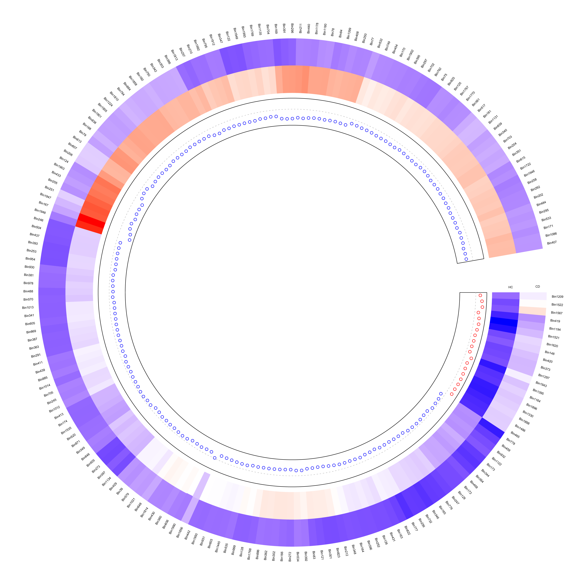


## 4. Cluster abundance violin plot

``` r
# Generate a violin plot for a selected feature/cluster
MBR_violin(
  # dataframe containing features
  data = significant_data,
  # matched sample metadata data frame
  meta_data = meta,
  # column name in metadata containing group labels
  group_col = "Group",
  # dataframe containing p-values
  pvalue_data = pvalue_data,
  # adjusted p-values or raw p-values (p.value)
  p = "p.adj",
  # colors used for group visualization
  colors = c('#FFADAD', '#DEDAF4'),
  # selected feature/cluster ID for plotting
  cluster = 1948,
  # outputs to the current working directory.
  out_path = './'
)
```

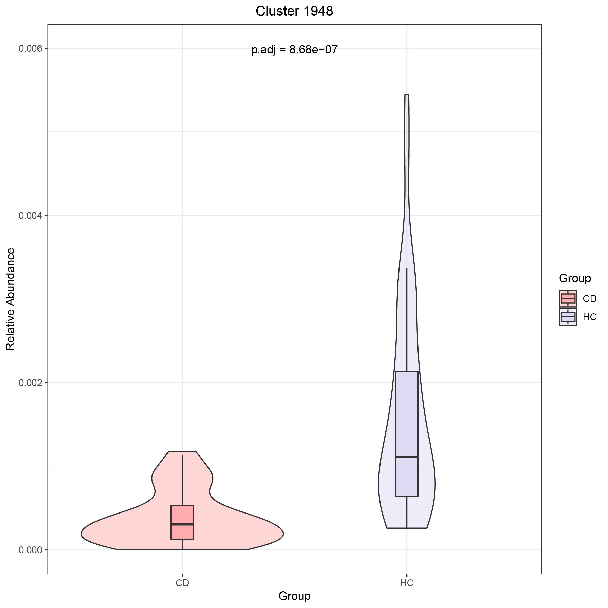

## 5. Beta diversity

``` r

# Perform beta diversity analysis and generate a PCoA plot
# `test` should be one of 'wilcox', 'ttest', 'kruskal', or 'anova'
MBR_beta(
  # dataframe containing features
  significant_data,
  # outputs to the current working directory.
  out_path = './',
  # statistical test method
  test = 'wilcox',
  meta_data = meta,
  # column name in metadata containing group labels
  group_name = 'Group',
  # colors used for group visualization
  colors = c('#FFADAD', '#DEDAF4')
)
```

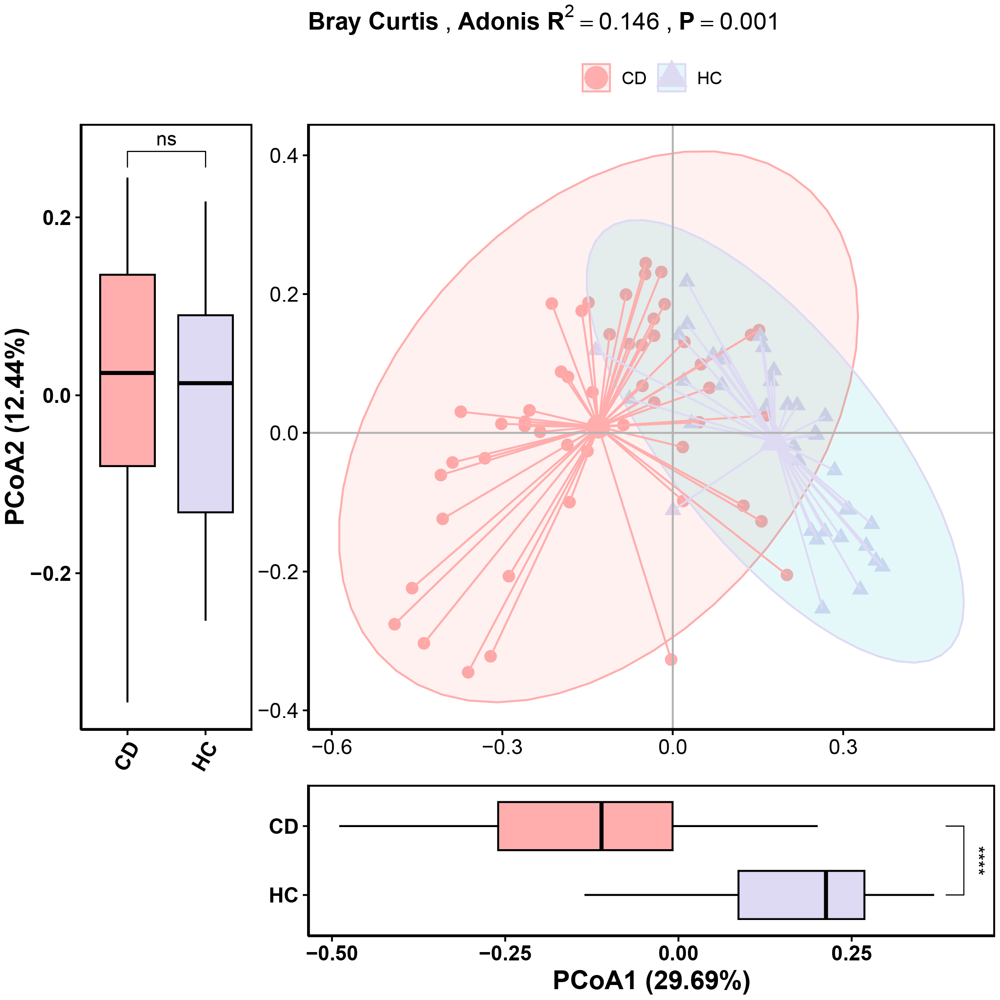

## 6. Feature selection

``` r
# Perform recursive feature elimination (RFE) for feature selection
# Random seeds are internally fixed for reproducibility.
# Run MBR_fs and store the selected features
selected_features <- MBR_fs(
  # dataframe containing features
  significant_data,
  # outputs to the current working directory
  out_path = './',
  # number of folds for cross-validation
  nfolds_cv = 5,
  # Requested number of clusters
  rfe_size = 199,
  # Number of selected features displayed in the plot
  top_n_features = 10,
  # column name in metadata containing group labels
  group_name = 'Group',
  # metadata
  meta_data = meta,
  # reference/control group used for comparison
  ref_group = 'CD',
  # colors used for visualization plots
  colors = c('#FFADAD', '#DEDAF4')
)
```

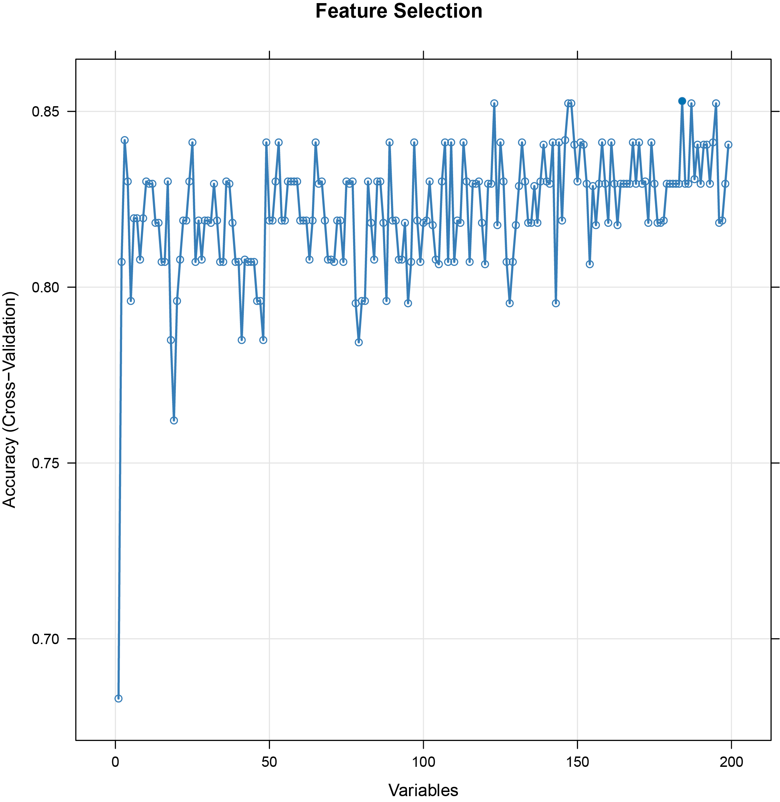


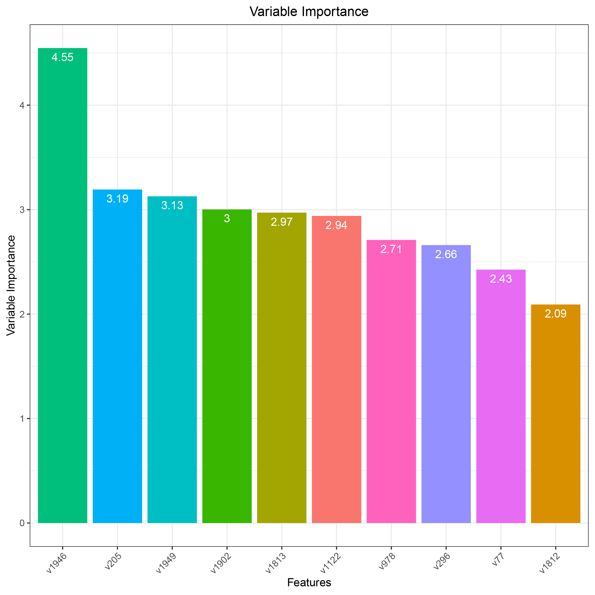


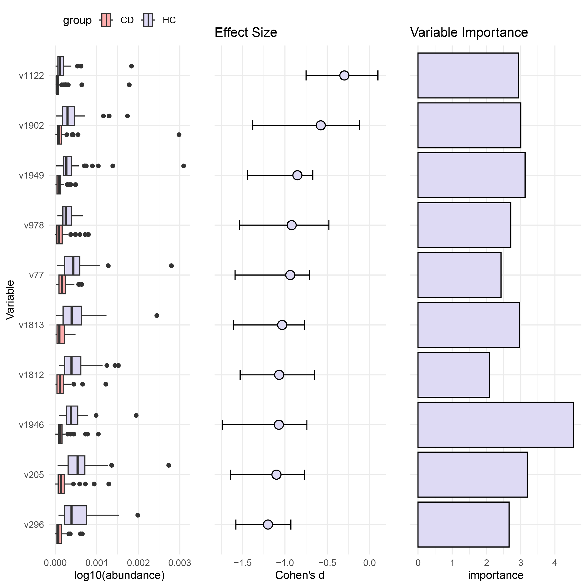


## 7. SOM channel heatmap

``` r
# Generate a heatmap for selected features
MBR_heatmap(
  # selected feature matrix for visualization
  data = MBR_selected_features,
  # SOM phenotype information
  cohonen_information = cohonen_information,
  # outputs to the current working directory
  out_path = './',
  # scaling method applied to rows
  scale = 'row',
  cluster_cols = FALSE,
  cluster_rows = TRUE,
  # whether to display numeric values in the heatmap
  display_numbers = FALSE
)
```

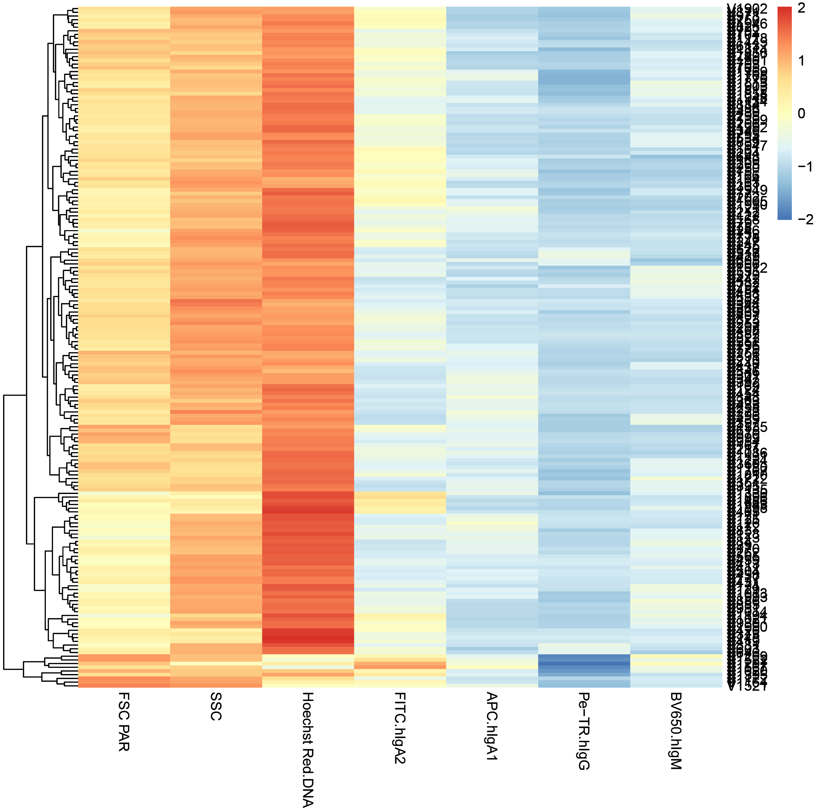


## 8. Mantel correlation

``` r
# Perform Mantel correlation analysis between selected features and metadata variables
MBR_mantel(
  # selected feature matrix
  data = selected_features[,1:10],
  # matched sample metadata data frame
  meta_data = meta,
  # clinical variable columns
  clinical_cols = c("Clinical1", "Clinical2"),
  # demographic variable columns
  demographic_cols = c("Demographic1", "Demographic2"),
  spec_select_names = list(
    # Label the clinical metadata block.
    A = "Clinical",
    # Label the demographic metadata block.
    B = "Demographic"
  ),
  # outputs to the current working directory
  out_path = './',
  # width of the output figure
  width = 6,
  # height of the output figure
  height = 6
)
```

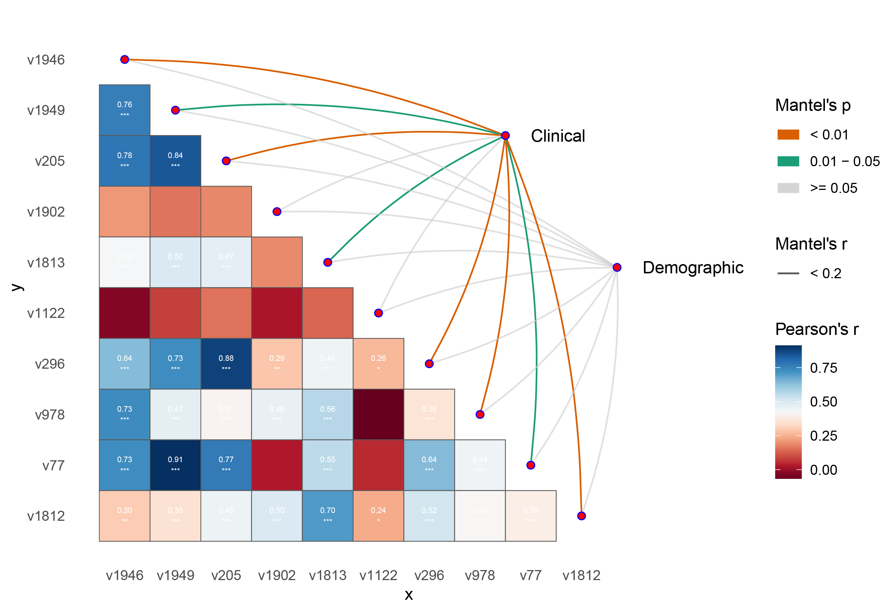


## 9. Random forest ROC diagnostic

``` r
MBR_ml(
  # feature table
  data = MBR_selected_features,
  # metadata
  meta_data = meta,
  # column name in metadata containing group labels
  group_name = 'Group',
  # outputs to the current working directory
  out_path = './',
  # reference group (e.g., "CD" or "HC")
  reference_level = 'CD',
  # width of the output plot PDF
  width = 6,
  # height of the output plot PDF
  height = 6,
  # resampling method
  method = 'repeatedcv',
  # number of folds
  number = 5,
  # number of repeats
  repeats = 2
)
```

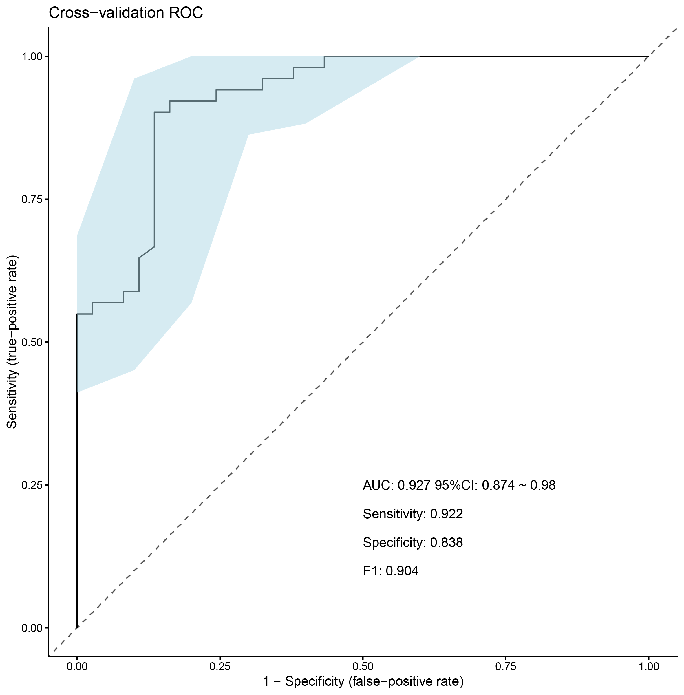

## 10. Confusion matrix

``` r
# Generate a confusion matrix and classification performance summary
MBR_conf(
  # feature table used for model evaluation
  data = MBR_selected_features,
  # matched sample metadata data frame
  meta_data = meta,
  # column name in metadata containing group labels
  group_name = 'Group',
  # reference group (e.g., "CD" or "HC")
  reference_level = 'CD',
  # outputs to the current working directory
  out_path = './'
)
```

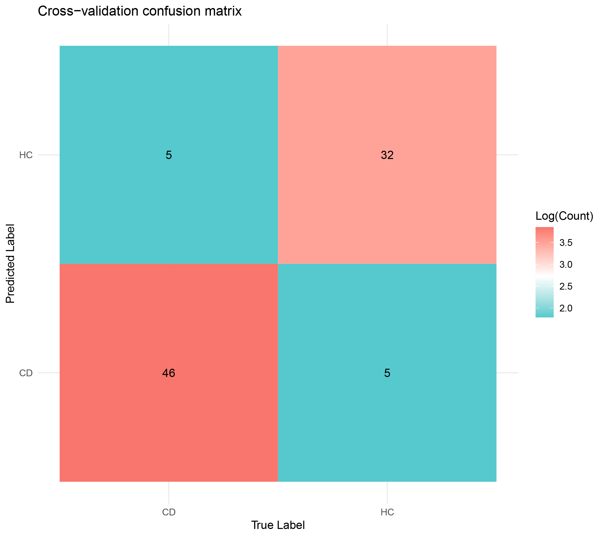

## 11. Reclustering

``` r
MBR_reclustering(data = cohonen_information, num_clusters = 1000)
```

## 12. Flow cytometry channel plots

``` r
# file_index = 1 selects the first mapped FCS sample.

# Define the directory containing 'FCS files generated from SOM processing'
# Locate mapped FCS files produced by SOM analysis.
rawdata_path <- "MappedFCS"

# Read the mapped FCS files into a flowSet.
fcs_files <- MBR_read(rawdata_path)

# Define selected SOM cluster IDs to visualize
# Choose the SOM cluster labels to visualize.
selected_rows <- c(
  'V1122','V1902','V1949','V978','V77','V1813','V1812','V1946','V205','V296'
)


# Define column name mappings between FCS channels and marker names
# Map acquisition-channel names to plotting labels.
column_mapping <- c(
  "FSC PAR"         = "FSC.PAR",
  "SSC"             = "SSC",
  "Hoechst.Red.DNA" = "Hoechst.Red",
  "Hoechst.Red"     = "Hoechst.Red",
  "Hoechst Red.DNA" = "Hoechst.Red",
  "FITC.hIgA2"      = "FITC",
  "FITC"            = "FITC",
  "APC.hIgA1"       = "APC",
  "APC"             = "APC",
  "Pe-TR.hIgG"      = "Pe.TR",
  "Pe.TR.hIgG"      = "Pe.TR",
  "Pe.TR"           = "Pe.TR",
  "BV650.hIgM"      = "BV650",
  "BV650"           = "BV650"
)

# Define marker/channel combinations for flow cytometry visualization
# Define scatter and fluorescence channel pairs.
plot_params <- list(
  list(x = "FSC.PAR", y = "SSC"),
  list(x = "FSC.PAR", y = "Hoechst.Red"),
  list(x = "FITC", y = "APC"),
  list(x = "Pe.TR", y = "BV650")
)

# Process a selected FCS file and apply signal transformation
# Prepare the selected FCS sample for channel plotting.
dat <- MBR_process(
  fcs_files,
  # Choose this position in the input FCS sample list.
  file_index = 1,
  # transformation for scaling
  transformation = function(x) 10^((4 * x) / 65000),
  # defined channel mapping
  column_mapping = column_mapping
)

# Prepare SOM clusters for downstream visualization
bins <- MBR_prepare(
  cohonen_information,
  # selected SOM clusters
  selected_rows = selected_rows,
  # transformation for scaling
  transformation = function(x) 10^((4 * x) / 65000),
  # defined channel mapping
  column_mapping = column_mapping
)

# Generate flow cytometry plots for selected channels and populations
plots <- MBR_plot(
  # processed flow cytometry data
  dat = dat,
  # processed SOM cluster bins
  bins = bins,
  # marker/channel combinations for plotting
  plot_params = plot_params,
  # selected SOM clusters
  selected_rows = selected_rows
)

# Display generated plots
# Display the four-panel channel-density plot.
print(plots)
```

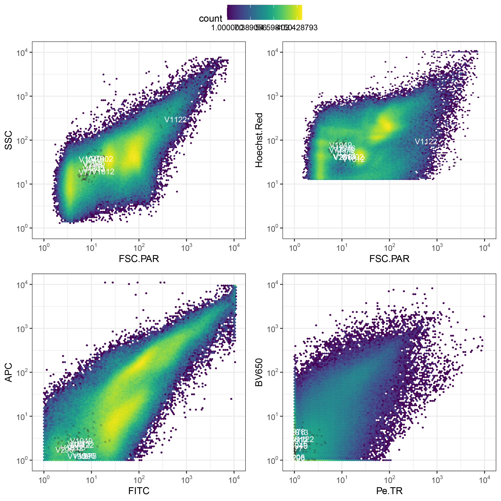

## 13. Export selected populations

``` r
# Use sample 1 consistently for processing and export metadata.

# Save selected gated populations/clusters as a new FCS file
MBR_save(
  # list of input FCS files
  fcs_files = fcs_files,
  # acquisition-scale events from the same source sample
  dat = export_dat,
  # selected clusters to export
  selected_rows = c("V9", "V10"),
  # Choose this position in the input FCS sample list.
  file_index = 1,
  # directory containing raw FCS files
  rawdata_path = rawdata_path
)
```

## 14. 16S rRNA gene sequencing

``` r
# Pre-processing
# Load metadata and feature abundance table
# Read the matched 16S sample metadata.
meta_16s <- read.delim('bac_meta.txt', header = TRUE, row.names = 1)

# Read the taxa-by-sample feature table.
count_table_16s <- read.delim('bac_data.txt', header = TRUE, row.names = 1)

# Calculate totals for the sample columns of the imported 16S table.
col_sums <- colSums(count_table_16s)
# Retain sample columns with positive totals.
count_table_filtered <- count_table_16s[, col_sums > 0]

# Transpose the count table.
# Transpose the feature table to samples in rows.
count_t <- as.data.frame(t(count_table_filtered))
meta_final <- meta_16s[rownames(count_t), , drop = FALSE]

stat_result_16s <- MBR_stat(
  data = count_t,
  meta_data = meta_final,
  group_col = "Group",
  test_type = "wilcox",
  cutoff = 0.1,
  correction = "none"
)

pvalue_data_16s <- stat_result_16s$pvalue

significant_data_16s <- stat_result_16s$significant

selected_features_16s<- MBR_fs(
  significant_data_16s,
  out_path = './',
  nfolds_cv = 5,
  rfe_size = 125,
  top_n_features = 10,
  group_name = 'Group',
  meta_data = meta_final,
  ref_group = 'CD',
  colors = c('#FFADAD', '#DEDAF4')
)

MBR_ml(
  data = selected_features_16s,
  meta_data = meta_final,
  group_name = 'Group',
  out_path = './',
  reference_level = 'CD',
  width = 6,
  height = 6,
  method = 'repeatedcv',
  number = 5,
  repeats = 2
)
```

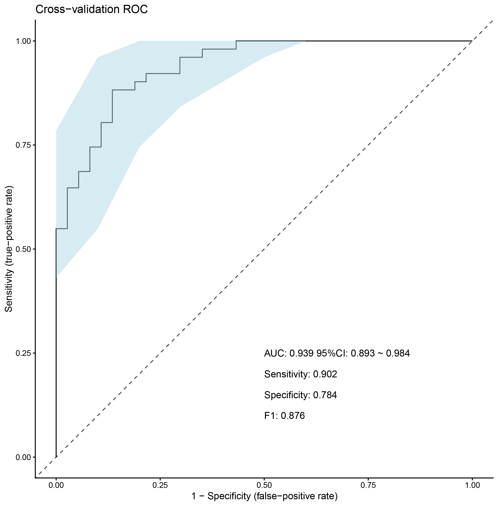


## 15. Transcriptomics

``` r

# Pre-processing
# Load metadata and feature abundance table
# Read the RNA sample metadata.
meta_rna <- read.delim(
  'meta_rna.txt',
  header = TRUE,
  row.names = 1
)

count_table_rna <- read_csv(
  'rnaibd.csv'
)

# Keep Symbol and numeric sample columns with positive totals.
# Retain Symbol and numeric columns with positive totals.
count_table_clean <- count_table_rna %>%
  select(
    Symbol,
    where(~ is.numeric(.) && sum(., na.rm = TRUE) > 0)
  )

# Convert the `Symbol` column into row names so that genes become rows prior to transposition
count_df <- count_table_clean %>%
  column_to_rownames(var = "Symbol")

# Transpose the count table so that samples are rows and genes/features are columns
count_t <- as.data.frame(t(count_df))

meta_final <- meta_rna[rownames(count_t), , drop = FALSE]

stat_result_RNA <-MBR_stat(
  data = count_t,
  group_col = 'Group',
  meta_data = meta_final,
  test_type = 'wilcox',
  out_path = './',
  correction = 'none',
  cutoff = 0.00001
)

pvalue_data_RNA <- stat_result_RNA$pvalue

significant_data_RNA <- stat_result_RNA$significant

MBR_ml(
  data = significant_data_RNA,
  meta_data = meta_final,
  group_name = 'Group',
  out_path = './',
  reference_level = 'UC',
  width = 6,
  height = 6,
  method = 'repeatedcv',
  number = 5,
  repeats = 2
)
```

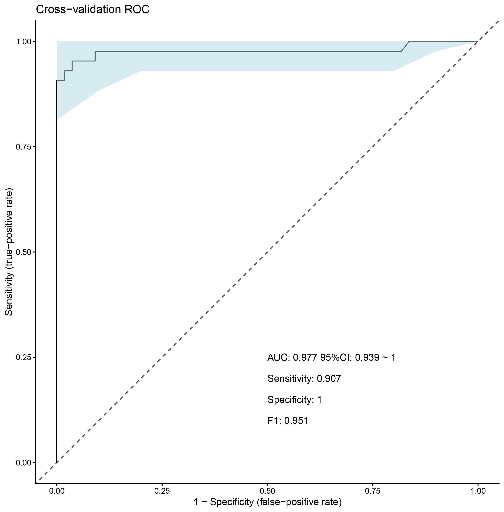
